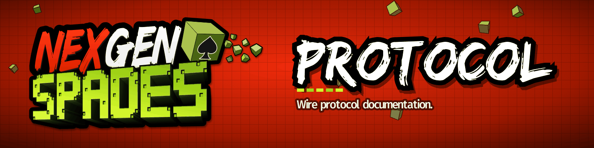

<p align="center"></p>

# ngspades Protocol

Documentation of the Ace of Spades **0.75/0.76** wire protocol and of
**protocol 1.0**, the protocol of ngspades-server, with C and
Godot examples.

Read online at
[ngspades.github.io/protocol](https://ngspades.github.io/protocol/), or as a
PDF: [the whole book](https://ngspades.github.io/protocol/pdf/ngspades-protocol.pdf).

## What is ngspades?

*ngspades* was an unfinished OpenSpades branch by yvt that worked toward a
next-generation Ace of Spades protocol ("strengtheningAo"); it was abandoned
years ago. The [ngspades organization](https://github.com/ngspades) is
reviving that work: [**Shoot and
Destroy**](https://ngspades.obex.pw/) is our client and server, a fork of
BetterSpades and of SpadesX's server. Its client speaks the classic
0.75/0.76 protocol, including the new extensions ZeroSpades registered
([aosprotocol](https://github.com/zerospades/aosprotocol)), and a public list,
and with our own server it speaks **protocol 1.0**, the finished form of what
ngspades started.

## Documents

The sources are [Typst](https://typst.app/) files in `src/pages/`.

| Page | Source | Covers |
| --- | --- | --- |
| [Overview](https://ngspades.github.io/protocol/) | `src/pages/index.typ` | versions, implementers, other resources |
| [Protocol 0.75 / 0.76](https://ngspades.github.io/protocol/protocol075) | `src/pages/protocol075.typ` | connection, every packet, game rules, the server list, how to write a server |
| [Protocol 1.0](https://ngspades.github.io/protocol/protocol10) | `src/pages/protocol10.typ` | connection over ENet and WebRTC, every packet, entities, trajectories, game mode state, a minimum client |
| [Extensions](https://ngspades.github.io/protocol/extensions) | `src/pages/extensions.typ` | the 0.75 extension negotiation and registry |
| [Master Server](https://ngspades.github.io/protocol/protocolmaster) | `src/pages/protocolmaster.typ` | the classic master and our HTTP master |
| [Ping](https://ngspades.github.io/protocol/protocolping) | `src/pages/protocolping.typ` | `HELLO`, `HELLOLAN`, `HELLOINFO`, map previews |
| [examples/c](examples/c/README.md), [examples/godot](examples/godot/README.md) | | C and GDScript codecs and connections |

## Building

Needs [Typst](https://github.com/typst/typst) 0.15 or later and Python 3.

```sh
make site     # site/ : HTML, style.css, 404.html and site/pdf/*.pdf
make check    # fidelity check against the old Markdown, then the link check
```

See [CONTRIBUTING.md](CONTRIBUTING.md).

## Contributing

A wire change is a protocol change: open an issue first. See
[CONTRIBUTING.md](CONTRIBUTING.md).

## Licence

The text is CC BY 4.0; the example code is MIT. See [LICENSE](LICENSE).
